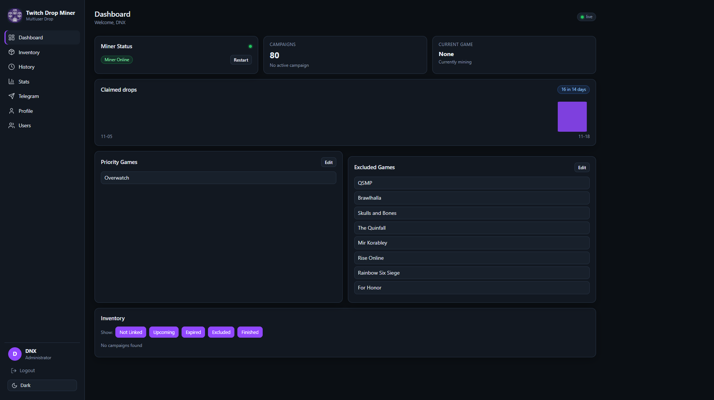
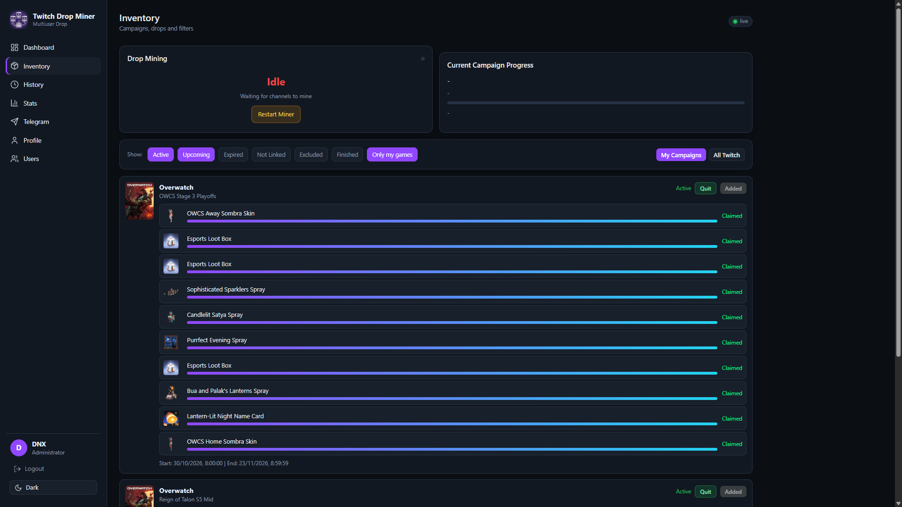
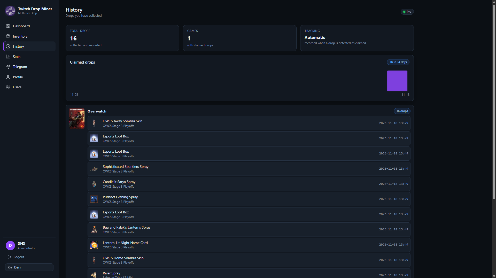
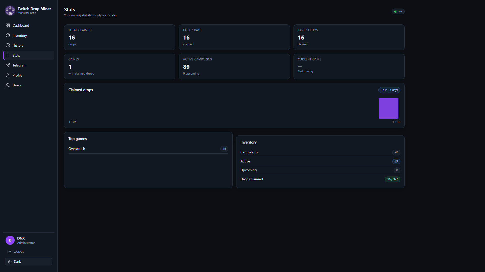
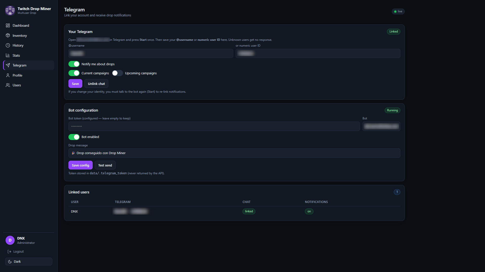
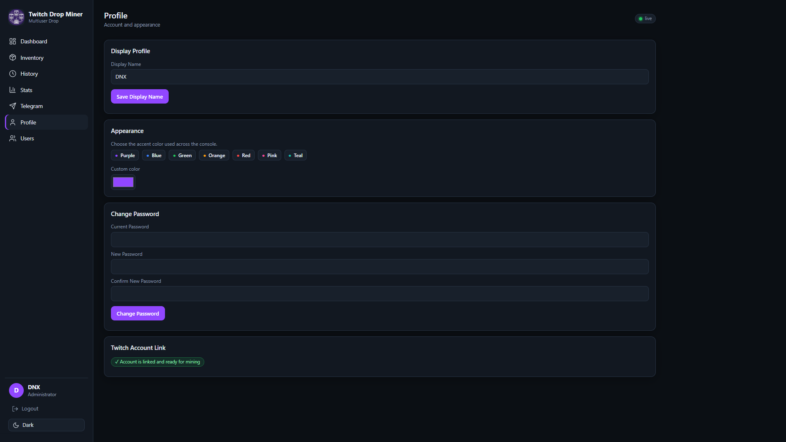
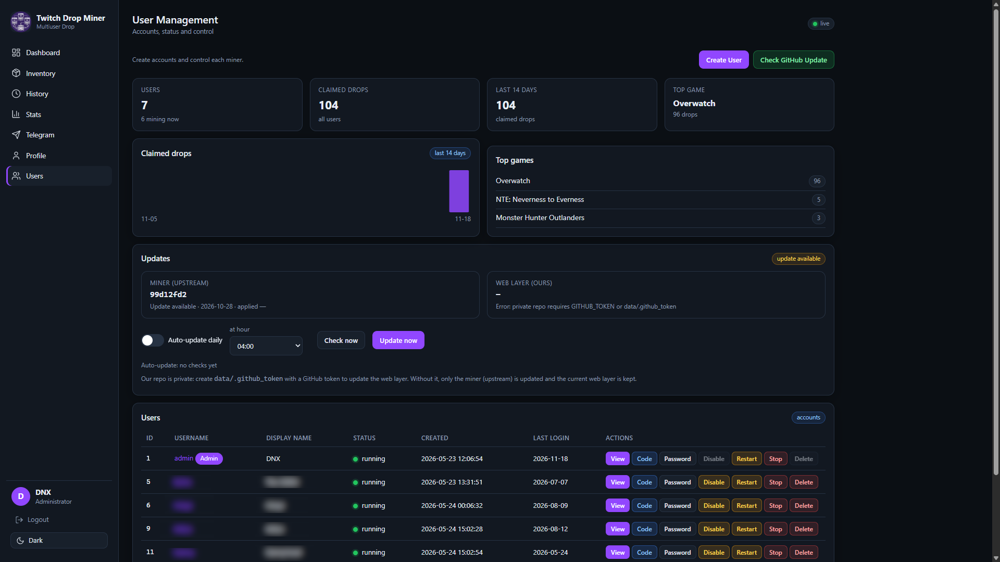
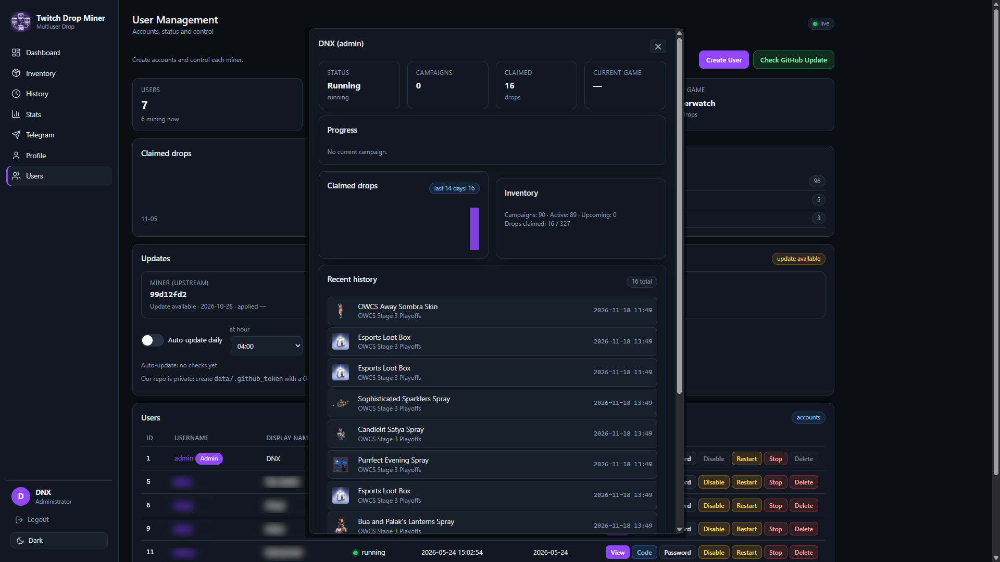

# Twitch Drops Miner — Consola Web Multiusuario


[](LICENSE)
[](https://www.python.org/)
[](Dockerfile)

**English:** [README.md](README.md)

Fork de [TwitchDropsMiner](https://github.com/DevilXD/TwitchDropsMiner) de **DevilXD** que convierte el minero de escritorio en un **servicio multiusuario autoalojado**: un minero headless por usuario, todos gestionados desde una consola web, con bot de Telegram opcional para estadísticas y avisos de drops.

El núcleo de minado es el original. Todo lo que hay en `web/` es lo que añade este fork.

> Sin relación con Twitch, DevilXD ni el proyecto original. Úsalo bajo tu responsabilidad y respetando los Términos de Servicio de Twitch.

---

## Qué añade este fork

| Área | TDM original | Este fork |
|---|---|---|
| Interfaz | GUI de escritorio (Tkinter) | **Consola web** (FastAPI + Jinja2), mismo núcleo |
| Cuentas | Una cuenta de Twitch | **Usuarios locales ilimitados**, cada uno con su minero y su carpeta |
| Operación | App local | **Subprocesos headless** gestionados por un runner, reiniciables desde el navegador |
| Monitorización | Pestañas de la GUI | **Dashboard, Inventario, Historial, Stats** por usuario + agregado de admin |
| Notificaciones | Popups de la bandeja | **Bot de Telegram** con `/stats`, avisos de drops y toggles current/upcoming |
| Actualizaciones | Descargar release a mano | **Updater integrado**: comprobar upstream, staging, verificación, backup, auto-reinicio |
| Despliegue | Paquetes de escritorio | **Docker** con `xvfb` y código montado desde disco |
| Estética | Tkinter | Sistema de diseño **DNX Web UI**: tema claro/oscuro, acento por usuario, drawer responsive |

---

## Capturas

### Dashboard
Estado del minero, gráfica de drops reclamados, juegos prioritarios/excluidos y contadores de inventario.



### Inventario
Todas las campañas del usuario con su progreso y filtros: `Active`, `Upcoming`, `Expired`, `Not Linked`, `Excluded`, `Finished`, más `Only my games` / `All Twitch`.



### Historial
Drops conseguidos, agrupados por juego/campaña, con fecha de detección y gráfica de 14 días.



### Stats
KPIs por usuario, top de juegos y resumen de inventario.



### Telegram
Vinculación por usuario (`@usuario` o ID numérico), toggles de notificación y configuración del bot para el admin.



### Perfil
Nombre visible, color de acento, cambio de contraseña y logout de la cuenta de Twitch.



### Gestión de usuarios (admin)
Cuentas, estado por usuario, control del minero, updater de GitHub y métricas agregadas.



### Vista por usuario (admin)
Instantánea en vivo de cualquier usuario: estado, campañas, drops reclamados, progreso e historial reciente.



---

## Arquitectura

```text
Navegador ──HTTP──► App FastAPI (web/app.py)
                        │
                        ├── SQLite users.db (argon2, sesiones)
                        │
                        └── MultiRunner (web/multi_runner.py)
                                │  lanza un subproceso por usuario
                                ▼
                        headless_miner.py  ──►  Twitch GQL + WebSocket
                                │
                                ▼
                        data/<user_id>/  (settings, cookies, progreso,
                                          cache de inventario, historial)
```

- `web/app.py` — rutas, autenticación por sesión, panel de admin, endpoints del updater.
- `web/auth.py` — usuarios (SQLite + argon2) y carpetas de datos por usuario.
- `web/multi_runner.py` — arranca/para/reinicia un `headless_miner.py` por usuario.
- `web/headless_miner.py` — el minero original sin GUI, escribiendo su estado en JSON.
- `web/telegram_bot.py` — bot global de Telegram (long polling, sin webhook).
- `web/github_update.py` — updater de upstream y de la capa web con staging y verificación.
- `web/templates/`, `web/static/` — interfaz (DNX Web UI).

La capa web nunca bloquea a los mineros: lee sus ficheros JSON
(`progress.json`, `inventory_cache.json`, `history.json`).

---

## Requisitos

- Python **3.10+** (núcleo del minero) y `tk` si ejecutas sin Docker.
- Linux/Docker: `tk`, `libtk8.6`, `tcl`, `xvfb` (ya incluidos en el `Dockerfile`).
- Un proxy inverso con TLS si lo expones fuera de tu LAN.

---

## Inicio rápido (Docker, recomendado)

```bash
git clone https://github.com/Deen0X/twitch-drop-miner-multiuser.git
cd twitch-drop-miner-multiuser
docker compose up -d --build
```

Abre `http://<host>:4295`.

El contenedor monta el repositorio en `/app`, así que los cambios de código no
requieren rebuild:

```bash
docker restart twitch-miner-multi
```

`start.sh` arranca el servidor web bajo `xvfb-run`, escribe en `output.log` y
mantiene el contenedor vivo.

## Inicio rápido (desde código)

```bash
python -m venv .venv
source .venv/bin/activate        # Windows: .venv\Scripts\activate
pip install -r requirements.txt
python main.py --web --port 4295
```

`main.py` conserva el modo GUI original; con `--web` arranca la consola.

---

## Primer acceso

- En el primer arranque se crea una cuenta admin:
  - usuario `admin`
  - contraseña leída de `config/admin_pass.txt` si existe, si no `admin`
- **Cámbiala de inmediato** en *Profile → Change Password*.
- El admin crea el resto de cuentas en *Users → Create User*. No hay registro
  público: está pensado para una instancia privada.
- Cada usuario vincula **su propia cuenta de Twitch** desde *Profile* con el
  flujo de device code (el código se muestra en la consola y se completa en
  twitch.tv). Las cookies se guardan por usuario en
  `data/<user_id>/cookies.jar`.
- *Profile → Log out of Twitch* para el minero del usuario, revoca el token en
  Twitch (`/oauth2/revoke`, igual que el botón *Invalidate* de upstream) y borra
  las cookies y el estado obsoleto (progreso e inventario). El historial de drops
  y los ajustes se conservan, y el minero se reinicia solo cuando la cuenta se
  vincula de nuevo.

---

## Estructura de datos

```text
data/
├── users.db                 # cuentas (hash argon2)
├── .secret_key              # clave de firma de sesiones
├── .telegram_token          # token del bot (la API nunca lo devuelve)
├── telegram_config.json     # bot activo/usuario/mensaje de drop
├── telegram_image_cache/    # imágenes normalizadas 600x800
└── <user_id>/
    ├── settings.json        # priority, excluded, filtros, flags de telegram
    ├── cookies.jar          # sesión de Twitch
    ├── progress.json        # campaña actual y progreso de drops
    ├── inventory_cache.json # snapshot de campañas/drops
    └── history.json         # drops detectados como reclamados por la web
```

Todo `data/` está ignorado por git. No lo subas nunca: contiene cookies de
sesión, hashes de contraseñas y el token del bot.

---

## Bot de Telegram (opcional)

1. Crea un bot con [@BotFather](https://t.me/BotFather) y copia el token.
2. Como admin: *Telegram → Bot configuration*, pega el token, activa el bot y
   guarda. El bot arranca al momento y registra `Telegram bot started as @tubot`.
3. Cada usuario: *Telegram → Your Telegram*, introduce el `@usuario` o el ID
   numérico, guarda y pulsa **Start** una vez en el chat. El primer mensaje
   autorizado vincula el `chat_id`.
4. Habla con el bot en **chat privado**. Los usuarios desconocidos y los grupos
   se ignoran a propósito.

| Comando | Descripción |
|---|---|
| `/start`, `/help` | Mensaje de vinculación/ayuda |
| `/stats` (alias `/status`) | Campañas activas del inventario del usuario con barras de drops |

Notas de comportamiento:

- `/stats` envía una foto por campaña (máx. 10) con caption tipo
  `<code>[▰▰▰▰▰▱▱▱▱▱] 050%  Nombre del drop</code>`.
- El filtrado replica el inventario web: activas, vinculadas (salvo que esté
  activo *Not Linked*) y, con *Only my games*, prioridad menos excluidas. Las
  campañas completas pero aún activas también se incluyen.
- Los toggles `Current campaigns` / `Upcoming campaigns` deciden qué se envía.
- Mientras un minero está arrancando, `/stats` avisa de que está iniciando en vez
  de decir que no hay campañas.
- Todas las imágenes se normalizan a **600×800** (recorte cover) para que los
  mensajes se vean uniformes.
- Un token = una instancia. No ejecutes el mismo bot en dos despliegues a la vez
  (Telegram responde `409 Conflict`).

---

## Updater integrado

Panel de admin → *Updates*:

- Comprueba el feed Atom del proyecto original en busca de versiones nuevas.
- Descarga en un directorio de staging, verifica (`py_compile` + contrato de la
  API del minero) y arranca la capa web antes de tocar la instalación real.
- Guarda un backup del código anterior, aplica la actualización y se reinicia.
- **Auto-actualización diaria** opcional a la hora que elijas.
- La capa web también puede actualizarse desde este fork. Si la alojas en un
  repositorio privado, facilita un token de GitHub en `data/.github_token`.

---

## Notas y limitaciones

> [!WARNING]
> No veas streams con la misma cuenta de Twitch mientras su minero está activo.
> El reporte de progreso se confunde y los drops pueden quedarse atascados.

- Twitch puede enviar un correo de "New Login" cuando un usuario vincula su
  cuenta. Es el login del propio minero, no una intrusión.
- El minero está pensado para un puñado de cuentas en una máquina de confianza.
  No está endurecido para registro abierto ni exposición pública.
- No se pueden minar campañas a las que la cuenta no está vinculada (igual que
  el proyecto original).
- Traducciones, empaquetado e interioridades del minero vienen de upstream; el
  empaquetado de GUI (AppImage/PyInstaller/EXE) no forma parte del flujo de este
  fork.

---

## Checklist de seguridad

- [ ] Cambiar la contraseña por defecto del admin.
- [ ] Poner la consola detrás de un proxy inverso con HTTPS.
- [ ] Mantener `data/` privado: `cookies.jar`, `users.db`, `.secret_key`,
      `.telegram_token`.
- [ ] Restringir quién puede llegar al puerto `4295`.

---

## Créditos

Proyecto original y núcleo de minado: **[DevilXD](https://github.com/DevilXD/TwitchDropsMiner)**
y sus colaboradores/traductores (la lista completa está en el README de upstream).
Gracias también a los mantenedores de traducciones cuyo trabajo va incluido en
`lang/`.

Capa web multiusuario, bot de Telegram, updater y DNX Web UI: **Deen0X**.

---

## Licencia

MIT, igual que el proyecto original.

```text
Copyright (c) 2024 DevilXD
Copyright (c) 2026 Deen0X (multiuser web layer)
```

Consulta [LICENSE](LICENSE) para el texto completo. El aviso de copyright y el
de permiso originales se mantienen sin cambios.
