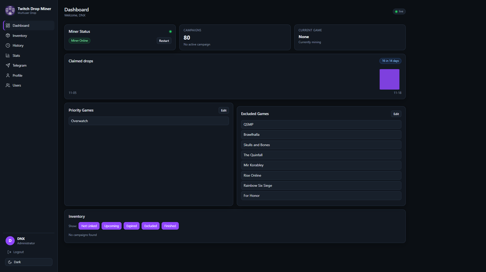
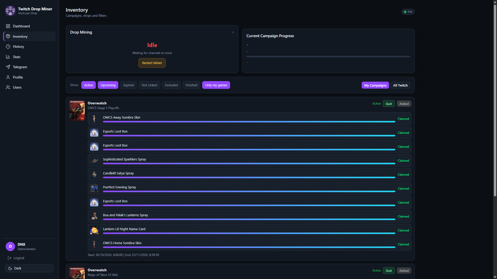
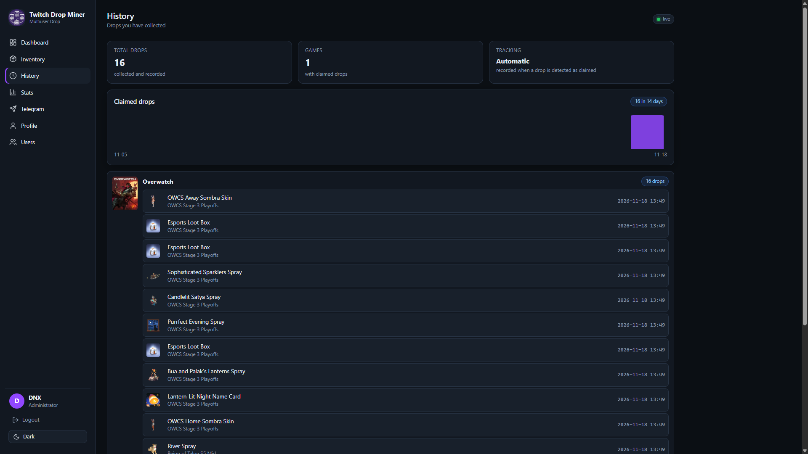
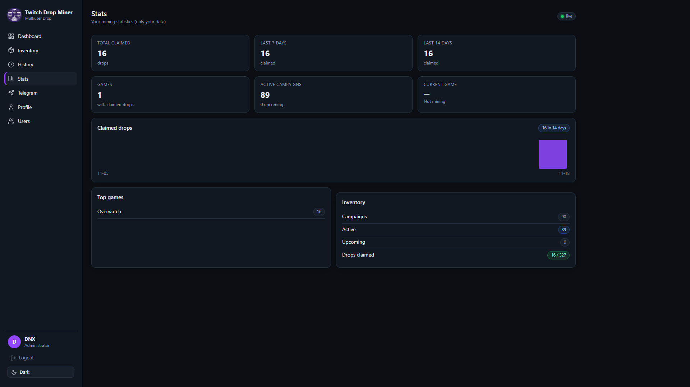
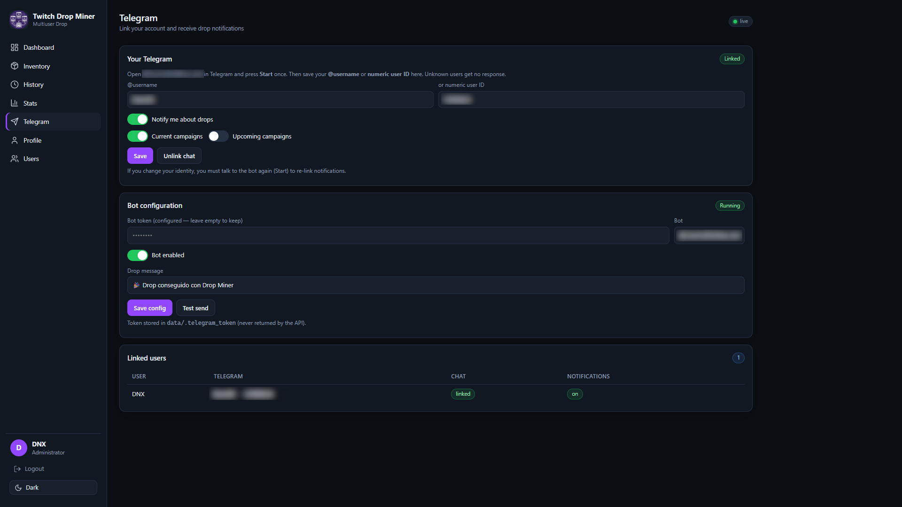
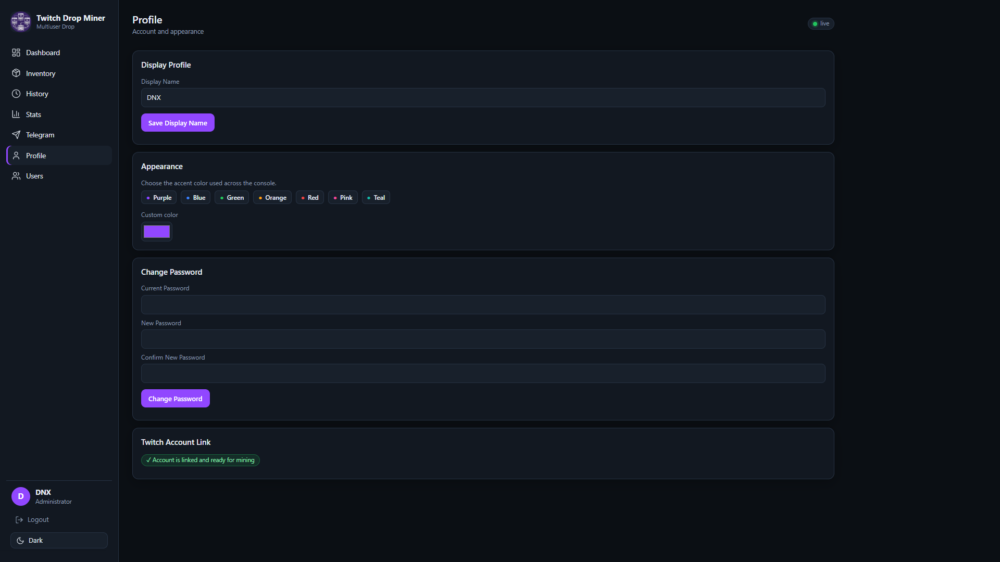
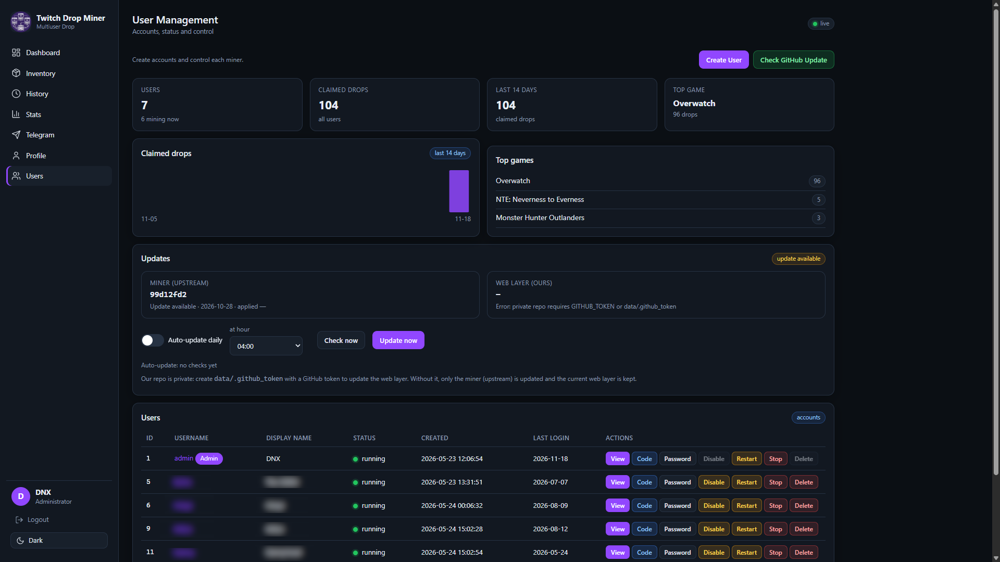
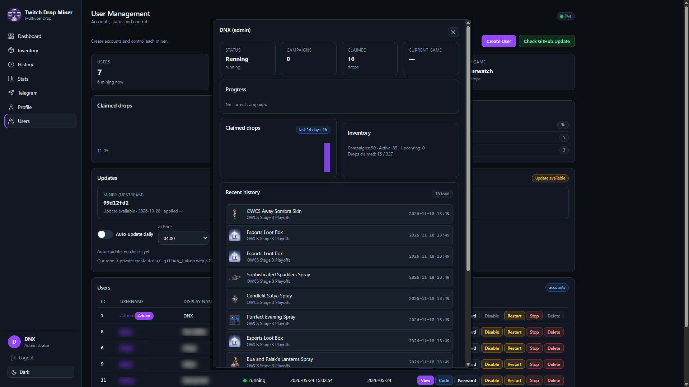

# Twitch Drops Miner — Multiuser Web Console

[](LICENSE)
[](https://www.python.org/)
[](Dockerfile)

**Español:** [README.es.md](README.es.md)

A fork of [TwitchDropsMiner](https://github.com/DevilXD/TwitchDropsMiner) by **DevilXD** that turns the desktop miner into a **self-hosted multiuser service**: one headless miner per user, all of them managed from a web console, with an optional Telegram bot for stats and drop notifications.

The mining core is the original one. Everything in `web/` is what this fork adds.

> Not affiliated with Twitch, DevilXD or the original project. Use it under your own responsibility and respect Twitch's Terms of Service.

---

## What this fork adds

| Area | Original TDM | This fork |
|---|---|---|
| Interface | Desktop GUI (Tkinter) | **Web console** (FastAPI + Jinja2), same miner core |
| Accounts | One Twitch account | **Unlimited local users**, each with its own miner and data directory |
| Operation | Local app | **Headless subprocesses** managed by a runner, restartable from the browser |
| Monitoring | GUI tabs | **Dashboard, Inventory, History, Stats** per user + admin aggregate |
| Notifications | Tray popups | **Telegram bot** with `/stats`, drop alerts and current/upcoming toggles |
| Updates | Manual release download | **Built-in updater**: upstream check, staging, verification, backup, auto-restart |
| Deployment | Desktop packages | **Docker** image with `xvfb`, code mounted from disk |
| Look & feel | Tkinter | **DNX Web UI** design system: dark/light theme, per-user accent colour, responsive drawer |

---

## Screenshots

### Dashboard
Miner state, claimed drops chart, priority/excluded games and inventory counters.



### Inventory
Every campaign of the user with drop progress and filters: `Active`, `Upcoming`, `Expired`, `Not Linked`, `Excluded`, `Finished`, plus `Only my games` / `All Twitch`.



### History
Drops collected, grouped by game/campaign, with detection date and a 14-day chart.



### Stats
Per-user KPIs, top games and inventory summary.



### Telegram
Per-user linking (`@username` or numeric ID), notification toggles and admin bot configuration.



### Profile
Display name, accent colour and password change.



### User management (admin)
Accounts, per-user state, miner control, GitHub updater and aggregated metrics.



### Per-user overview (admin)
Live snapshot of any user: state, campaigns, claimed drops, progress and recent history.



---

## Architecture

```text
Browser ──HTTP──► FastAPI app (web/app.py)
                     │
                     ├── SQLite users.db (argon2 passwords, sessions)
                     │
                     └── MultiRunner (web/multi_runner.py)
                             │  spawns one subprocess per user
                             ▼
                     headless_miner.py  ──►  Twitch GQL + WebSocket
                             │
                             ▼
                     data/<user_id>/  (settings, cookies, progress,
                                       inventory cache, history)
```

- `web/app.py` — routes, session auth, admin panel, updater endpoints.
- `web/auth.py` — user store (SQLite + argon2), user data directories.
- `web/multi_runner.py` — starts/stops/restarts one `headless_miner.py` per user.
- `web/headless_miner.py` — the original miner running without GUI, writing JSON state.
- `web/telegram_bot.py` — global Telegram bot (long polling, no webhook).
- `web/github_update.py` — upstream/web-layer updater with staging and verification.
- `web/templates/`, `web/static/` — UI (DNX Web UI).

The web layer never blocks on the miners: it reads their JSON files
(`progress.json`, `inventory_cache.json`, `history.json`).

---

## Requirements

- Python **3.10+** (the miner core), `tk` available if you run without Docker.
- Linux/Docker: `tk`, `libtk8.6`, `tcl`, `xvfb` (already in the `Dockerfile`).
- A reverse proxy with TLS if you expose it outside your LAN.

---

## Quick start (Docker, recommended)

```bash
git clone https://github.com/Deen0X/twitch-drop-miner-multiuser.git
cd twitch-drop-miner-multiuser
docker compose up -d --build
```

Open `http://<host>:4295`.

The container mounts the repository at `/app`, so code changes don't need a
rebuild:

```bash
docker restart twitch-miner-multi
```

`start.sh` runs the web server under `xvfb-run`, logs to `output.log` and keeps
the container alive.

## Quick start (from source)

```bash
python -m venv .venv
source .venv/bin/activate        # Windows: .venv\Scripts\activate
pip install -r requirements.txt
python main.py --web --port 4295
```

`main.py` keeps the original GUI mode available; `--web` starts the console
instead.

---

## First login

- On first run an admin account is created:
  - username `admin`
  - password read from `config/admin_pass.txt` if that file exists,
    otherwise `admin`
- **Change it immediately** in *Profile → Change Password*.
- Admins create the rest of the accounts in *Users → Create User*. There is no
  public sign-up: this is meant for a private instance.
- Each user links **their own Twitch account** from *Profile* using the device
  code flow (the code is shown in the console and completed on twitch.tv).
  Cookies are stored per user in `data/<user_id>/cookies.jar`.

---

## Data layout

```text
data/
├── users.db                 # accounts (argon2 hashes)
├── .secret_key              # session signing key
├── .telegram_token          # bot token (never returned by the API)
├── telegram_config.json     # bot enabled/username/drop message
├── telegram_image_cache/    # normalised 600x800 images
└── <user_id>/
    ├── settings.json        # priority, excluded, filters, telegram flags
    ├── cookies.jar          # Twitch session
    ├── progress.json        # current campaign and drop progress
    ├── inventory_cache.json # campaigns/drops snapshot
    └── history.json         # claimed drops detected by the web layer
```

Everything under `data/` is ignored by git. Never commit it: it contains
session cookies, password hashes and the bot token.

---

## Telegram bot (optional)

1. Create a bot with [@BotFather](https://t.me/BotFather) and copy the token.
2. As admin: *Telegram → Bot configuration*, paste the token, enable the bot and
   save. The bot starts immediately and logs `Telegram bot started as @yourbot`.
3. Each user: *Telegram → Your Telegram*, enter the `@username` or the numeric
   user ID, save, then press **Start** once in the chat. The first authorized
   message links the `chat_id`.
4. Mention the bot or send a command in a **private chat**. Unknown users and
   group chats are ignored on purpose.

| Command | Description |
|---|---|
| `/start`, `/help` | Link/help message |
| `/stats` (alias `/status`) | Active campaigns of the user's inventory with drop bars |

Behaviour notes:

- `/stats` sends one photo per campaign (max 10) with a caption like
  `<code>[▰▰▰▰▰▱▱▱▱▱] 050%  Drop name</code>`.
- Campaign filtering mirrors the web inventory: active, linked (unless
  *Not Linked* is on) and, with *Only my games*, priority minus excluded.
  Campaigns that are complete but still active are included.
- `Current campaigns` / `Upcoming campaigns` toggles decide what is sent.
- While a miner is booting, `/stats` replies that the miner is starting instead
  of pretending there are no campaigns.
- All images are normalised to **600×800** (cover crop) so messages look uniform.
- One token = one running instance. Don't run the same bot in two deployments
  at once (Telegram answers `409 Conflict`).

---

## Built-in updater

Admin panel → *Updates*:

- Checks the original project's Atom feed for new miner versions.
- Downloads to a staging directory, verifies (`py_compile` + miner API contract)
  and boots the web layer before touching the live install.
- Keeps a backup of the previous code, applies the update and restarts itself.
- Optional **daily auto-update** at a chosen hour.
- The web layer can also be updated from this fork. If you host it in a private
  repository, provide a GitHub token in `data/.github_token`.

---

## Notes and limitations

> [!WARNING]
> Do not watch streams with the same Twitch account while its miner is running.
> Progress reporting gets confused and drops can appear stuck.

- Twitch may send a "New Login" email when a user links an account. That's the
  miner's own login, not an intrusion.
- The miner is intended for a handful of accounts on a trusted machine. It is
  not hardened for open registration or public exposure.
- Campaigns outside the account's linked campaigns cannot be mined (same as the
  original project).
- Translations, packaging and the mining internals come from upstream; GUI
  packaging (AppImage/PyInstaller/EXE) is not part of this fork's workflow.

---

## Security checklist

- [ ] Change the default admin password.
- [ ] Put the console behind a reverse proxy with HTTPS.
- [ ] Keep `data/` private: `cookies.jar`, `users.db`, `.secret_key`,
      `.telegram_token`.
- [ ] Restrict who can reach port `4295`.

---

## Credits

Original project and mining core: **[DevilXD](https://github.com/DevilXD/TwitchDropsMiner)**
and its contributors/translators (see the upstream README for the full list).
Thanks also to the translation maintainers whose work is bundled in `lang/`.

Multiuser web layer, Telegram bot, updater, DNX Web UI: **Deen0X**.

---

## License

MIT, same as the original project.

```text
Copyright (c) 2024 DevilXD
Copyright (c) 2026 Deen0X (multiuser web layer)
```

See [LICENSE](LICENSE) for the full text. The original copyright notice and
permission notice are kept unchanged.
